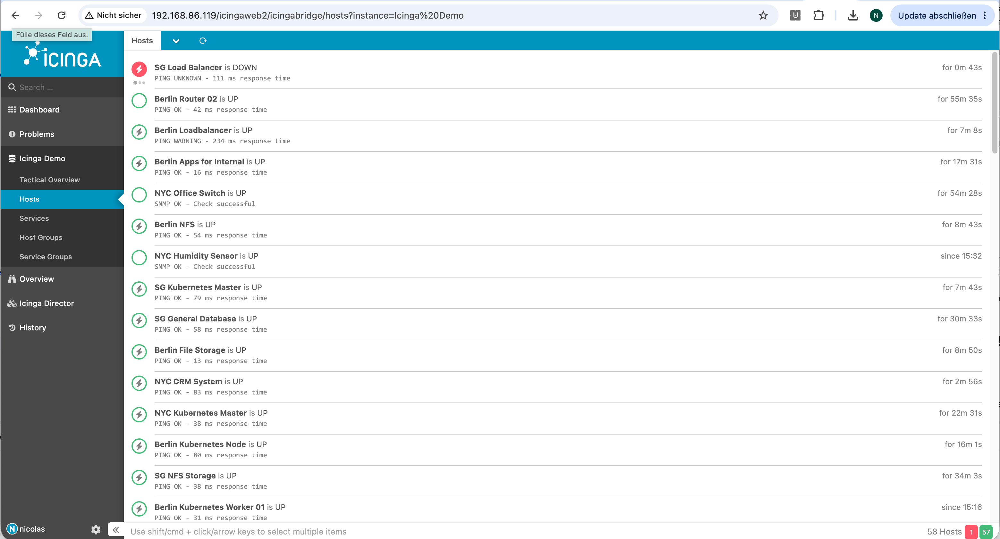

# About the Icingabridge Module 

The `icingabridge` module bridges independent Icinga instances together, allowing
them to be integrated seamlessly into a single Icinga Web 2 frontend. It connects
to a remote instance either through the full **IcingaDB Web REST API** or, as a
limited fallback, through the **Icinga 2 REST API (v1)**.

This is useful whenever you want to monitor the status of a separate Icinga
installation without setting up a full distributed monitoring setup. Common use
cases are:

* Bridging between **production and test environments**.
* Bridging between **internal systems and customer systems**.
* Emergency access to icinga2 api if the database is not available.
* Aggregating the status of several independent instances into one overview.

## Features

* **Remote instance bridging** – view tactical overviews, hosts, services and
  groups of a remote instance directly in your local Icinga Web 2.
* **Two backends** – the primary backend is the IcingaDB Web API. As an
  alternative, a limited Icinga 2 API backend is available which is also useful
  as an **emergency dashboard** when the main database is not working.
* **Director integration** – remote checks can be imported from a remote instance via an
  Icinga Director import source, so checks can be executed against the check
  result of the remote instance.
* **Performance data** – performance data of the remote checks is carried over
  and flows seamlessly into the local monitoring.
* **Public views via API key** – a view can be published for access with an API
  key only, for example on a wallboard. A key is always bound to exactly one URL
  and does not log the user into the system.
* **Database independent** – the module is designed to work even when the
  database is not available, because the Icinga 2 API backend can serve
  monitoring information directly from the running Icinga 2 instance.
* **optional one Minute file cache** – the module can cache requests for a minute, and optimize some queries for that.
This becomes in handy in case a ratelimit proxy is used.

## Architecture

The module is built around an abstraction layer that hides the differences
between the two backends:

| Component | Description |
|-----------|-------------|
| `IcingadbRestApi` | Primary backend using the IcingaDB Web REST API. Offers the full feature set. |
| `Icinga2RestApi` | Limited backend using the Icinga 2 REST API (v1). Used as a fallback and for emergency dashboards. |
| Director hooks (`ImportSource`, `PropertyAppendImports`) | Import remote objects into the Icinga Director and append host templates. |

## Related Documentation

Please read the following chapters for more insights on this module:

* [Installation](02-Installation.md#module-icingabridge-installation)
* [Configuration](03-Configuration.md#module-icingabridge-configuration)
* [Usage](04-Usage.md#module-icingabridge-usage)
* [Commands](05-Commands.md)
