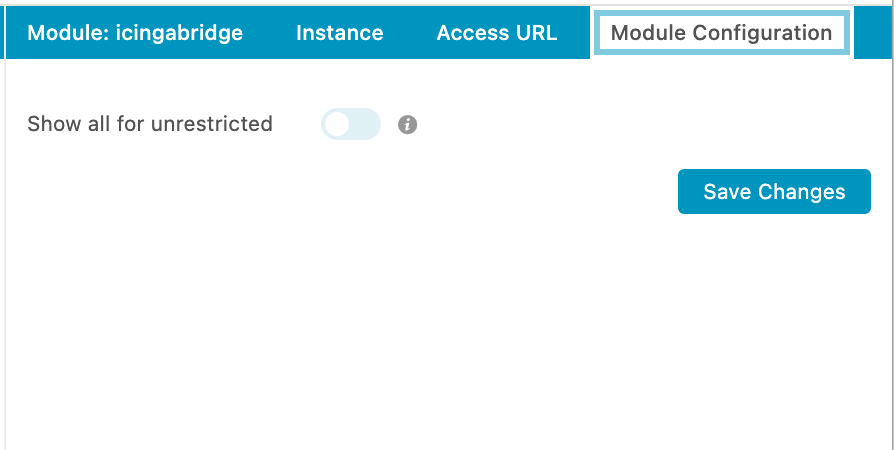
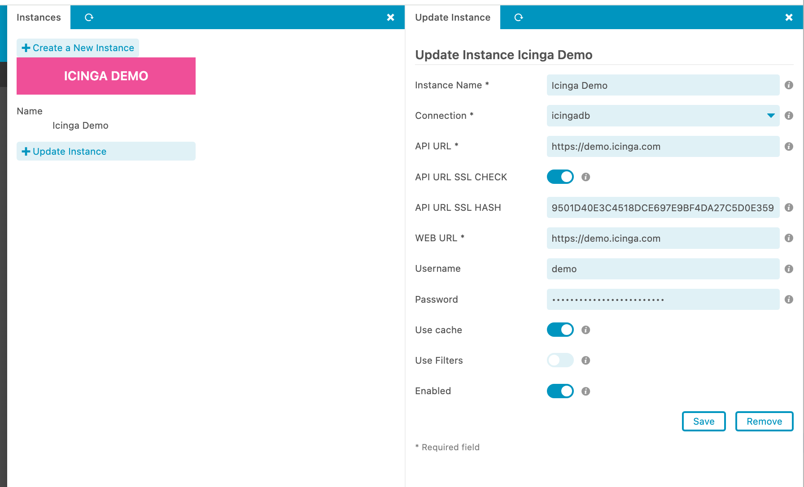
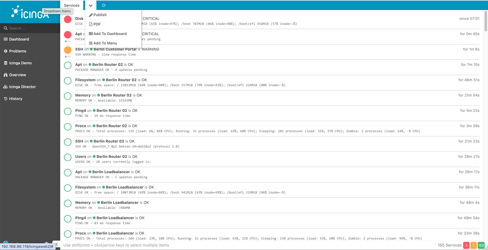
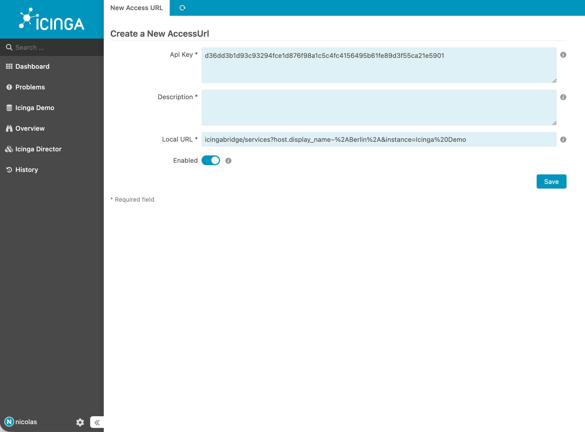
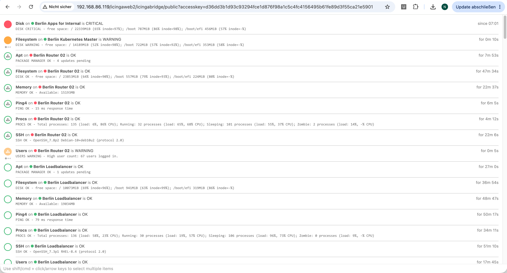
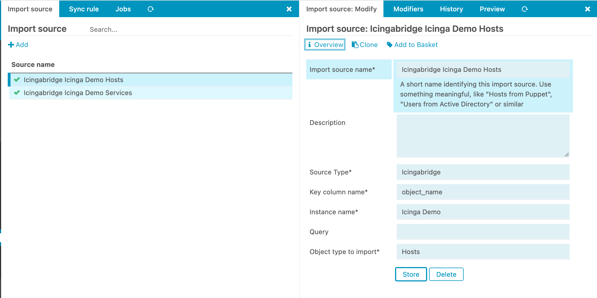
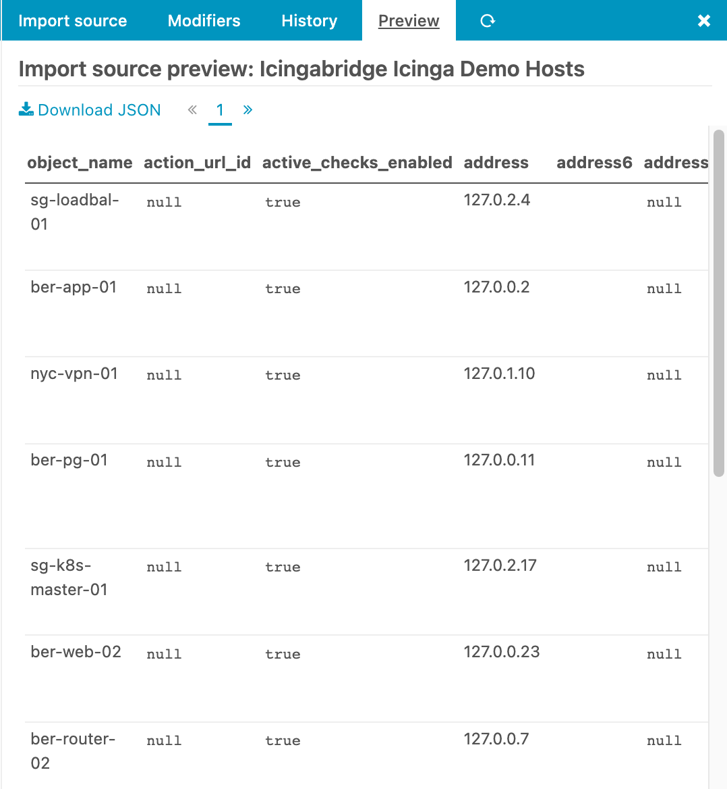
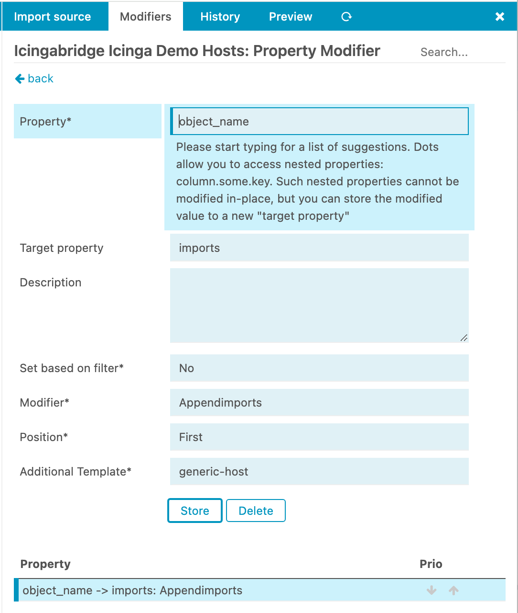
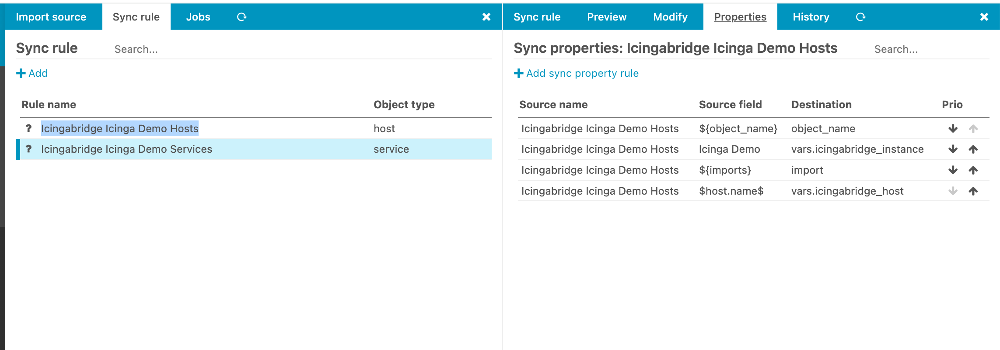
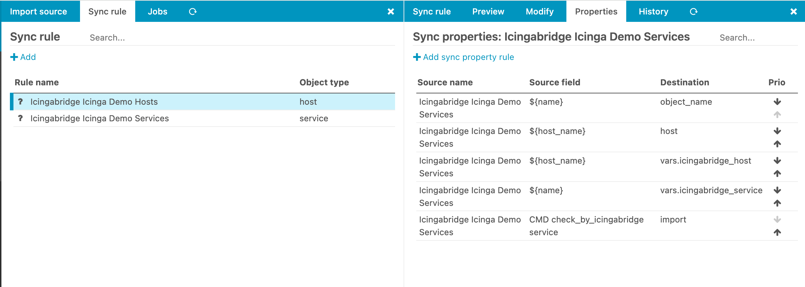

# Configuration <a id="module-icingabridge-configuration"></a>

The module offers three configuration areas, available as config tabs under
`Configuration` in the Icinga Web 2 menu:

* **Module Configuration** – global module settings.
* **Instance** – the bridged remote instances.
* **Access URL** – public views that can be reached with an API key.

## Module Configuration <a id="module-icingabridge-configuration-module"></a>



The module does not show instances for unrestricted users by default, as this can float the admin menu.
You can apply the restriction rolebased or temporary enable show_all_for_unrestricted´

| Setting | Required | Default | Description |
|---------|----------|---------|-------------|
| `settings.show_all_for_unrestricted` | no | `0` | Show all menus for unrestricted users. When disabled you can instead apply the restriction `*` to the role to grant access to all instances. |

## Instance <a id="module-icingabridge-configuration-instance"></a>



Each entry represents one remote Icinga instance that is bridged into this
Icinga Web 2. Instances are stored in an INI file and used to build the sidebar
menu and to authenticate against the remote backend.

| Field | Required | Description |
|-------|----------|-------------|
| `name` | **yes** | Unique name of the instance. Used in the menu and as a restriction/match key. |
| `connection` | **yes** | The backend to connect to. One of `icingadb` (full IcingaDB Web API), `icinga2api` (limited Icinga 2 REST API v1) or `icingadbfilebased` (file based, for demo and test purposes). |
| `apiurl` | **yes** | URL of the remote endpoint used for API requests. For `icingadb` this is the IcingaDB Web API base URL, for `icinga2api` the Icinga 2 REST API base URL. |
| `apiurl_verify_by_hash_only` | no | By default ssl will be verified against the truststore, for a self-signed certificate you can enable this setting so the certificate will only be validated against the stored hash (insecure), this is necessary for a local icinga2 api. |
| `apiurl_hash` | no | Expected SHA-256 hash of the SSL certificate. Only relevant for HTTPS connections with SSL checks enabled. Set automatically when the URL is HTTPS. |
| `weburl` | **yes** | URL of the remote Icinga Web 2, used for links in the dashboards back to the original instance |
| `username` | no | Username for API authentication. |
| `password` | no | Password for API authentication. The value is protected and never exposed in the UI. |
| `use_cache` | no | Enable a one-minute file cache for API requests to reduce the number of requests. |
| `use_filters` | no | Enable filters when fetching, otherwise filtering is done in php. This can speed up or slow down fetching depending on the number of hosts/services. This should be disabled if the cache is enabled. |
| `enabled` | no | Enable or disable the instance. Disabled instances are not shown in the menu. |

## Access URL <a id="module-icingabridge-configuration-accessurl"></a>

To create a published view, navigate to, for example, the instance's host list, click on tab options and click on publish.
You can also apply a filter query, in icingadb syntax.


An Access URL publishes a single view for access with an API key only. This is
intended for scenarios such as a **wallboard**. Access with an API key never logs
the user into the system and is always restricted to exactly one URL.

| Field | Required | Description |
|-------|----------|-------------|
| `apikey` | **yes** | Secret key used to access the URL. Generated automatically (SHA-256) on insert and cannot be changed on update. |
| `entrydescription` | **yes** | Human-readable description of the entry. |
| `local_url` | **yes** | The internal icingabridge URL of the page you want to publish. |
| `author` | no | Automatically set to the user who created the entry. |
| `enabled` | no | Enable or disable the access URL. |



To access a published view, append the API key as a query parameter, for example:

```
https://your-icingaweb2/icingabridge/public?accesskey=<your-api-key>
```


## Director <a id="module-icingabridge-configuration-director"></a>

The module provides two hooks for the Icinga Director:

### Import Source – "Icingabridge"



Imports hosts or services from a bridged remote instance into the Director so
that checks can be executed against the check result of the remote instance.

| Setting | Required | Description |
|---------|----------|-------------|
| `instance` | **yes** | The name of the bridged instance (see the Instance configuration). |
| `mode` | **yes** | Object type to import: `Hosts` or `Services`. Not all object types are supported. |
| `query` | no | An IcingaDB compatible search query. |

The key column of the import is `object_name`. For hosts this is the host name;
for services it is `host!service`.




### Property Modifier – "Appendimports"



Appends a host template to the `imports` property of a host, and fetches the current one.

| Setting | Required | Description |
|---------|----------|-------------|
| `additional_template` | **yes** | Host template to append. |
| `add_position` | no | Where to insert the template: `first` or `last` (default). |


### Sync Rule – "Icingabridge"

After successful import you can sync the data to actual Icinga Director objects.
Here are examples of working sync rules. The host rule makes use of the previously generated imports using the
Property Modifier `Appendimports`



For the service sync rule, please use your service template which uses the icingabridge cli command, with the service action.
This is covered here [Commands](05-Commands.md)


