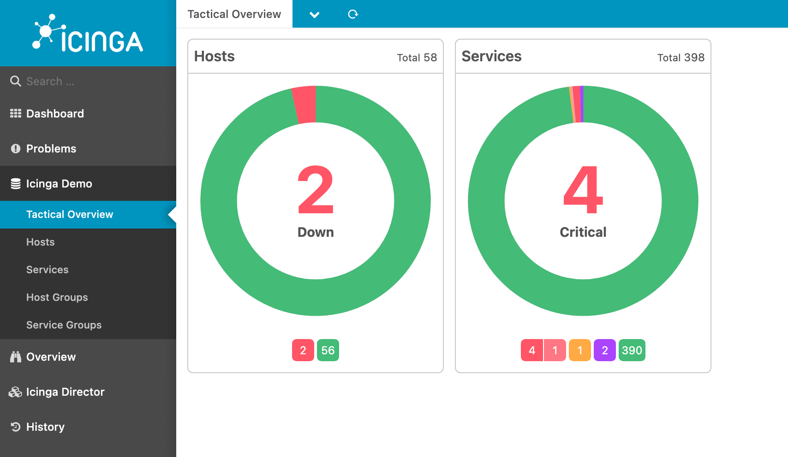
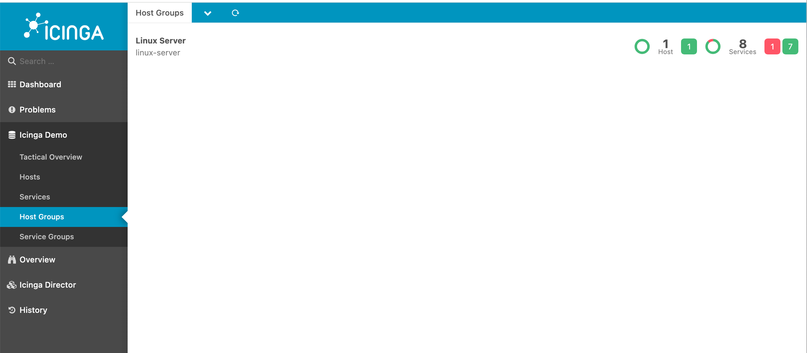

# Usage 

Once at least one instance is configured and enabled, the module adds a sidebar
section per instance. Each section exposes the following views:

* **Tactical Overview** – summary donut charts for hosts and services.
* **Hosts** – list of hosts.
* **Services** – list of services.
* **Host Groups** – list of host groups.
* **Service Groups** – list of service groups.

Menu entries are only rendered for instances the current user has permission to
see. Permissions are resolved through the `icingabridge/instance/show-menu` and
`icingabridge/instance/filter` restrictions.

## Tactical Overview 

The tactical overview shows aggregated host and service states as donut charts.
The page auto-refreshes every 10 seconds. The summary is fetched from the
configured backend:

* For the `icingadb` backend the IcingaDB Web tactical endpoint is used, with a
  service-query based fallback if the endpoint is unavailable.
* For the `icinga2api` backend the summary is computed from the fetched hosts and
  services.

## Hosts, Services and Groups 

The host, service and group views behave like the corresponding views of the
local monitoring. 

Performance data of the imported remote checks is carried over and
flows seamlessly into the local monitoring. The `icinga2api` backend additionally
compiles IcingaDB style filter expressions into Icinga 2 API filters and applies
sorting locally.

## Director Import 

Objects from a bridged instance can be imported into the Icinga Director. This is
used to run checks against the check result of the remote instance.

1. Create a new **Import Source** of type **Icingabridge**.
2. Select the bridged `instance`, the import `mode` (`Hosts` or `Services`) and
   optionally an IcingaDB compatible `query`.
3. Use the imported objects in your Director rules.

The `PropertyAppendImports` modifier can be used to automatically append a host
template to the imports of existing hosts.

## Public Views / Wallboard 

A view can be published for access with an API key only, for example on a wallboard.
This is done in the **Access URL** configuration:

1. Create an Access URL with a description, the internal `local_url` and the
   target view.
2. The API key is generated automatically. Use it as the `accesskey` query
   parameter when calling the published URL.

Access with an API key is restricted to exactly one view, does not log the user
into the system and does not grant any other permissions.

## Emergency Dashboard 

Because the module is database independent, it keeps working even when the
database is not functioning. By configuring an instance with the `icinga2api`
connection, an administrator can reach monitoring information directly from the
running Icinga 2 instance, even when the rest of the system is no longer
available. This makes the Icinga 2 backend a useful emergency dashboard.
